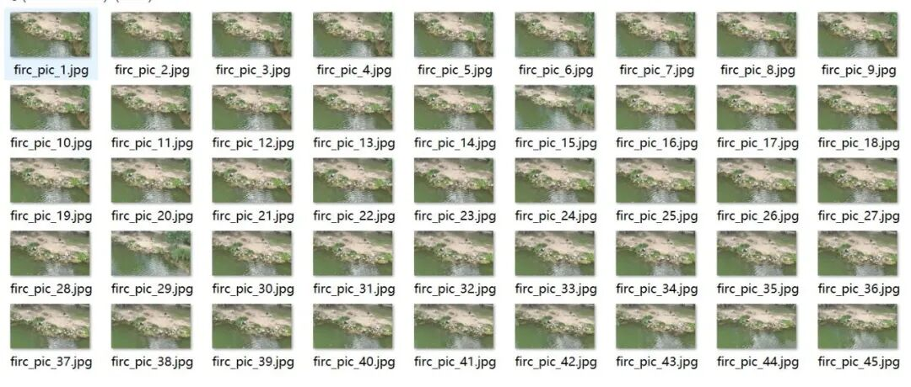
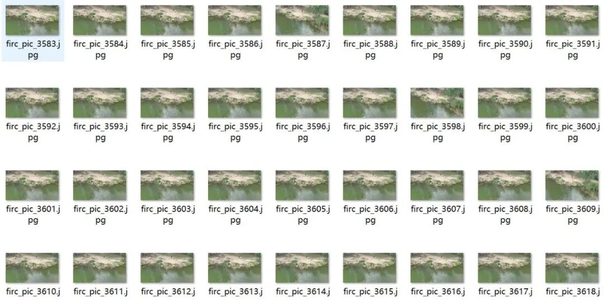
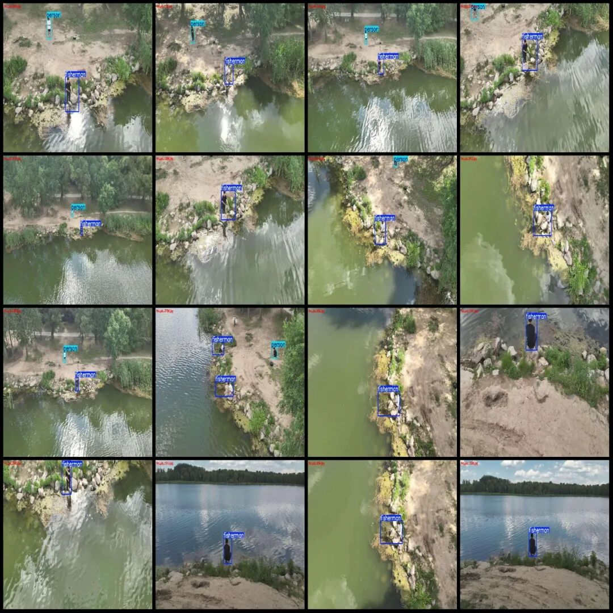
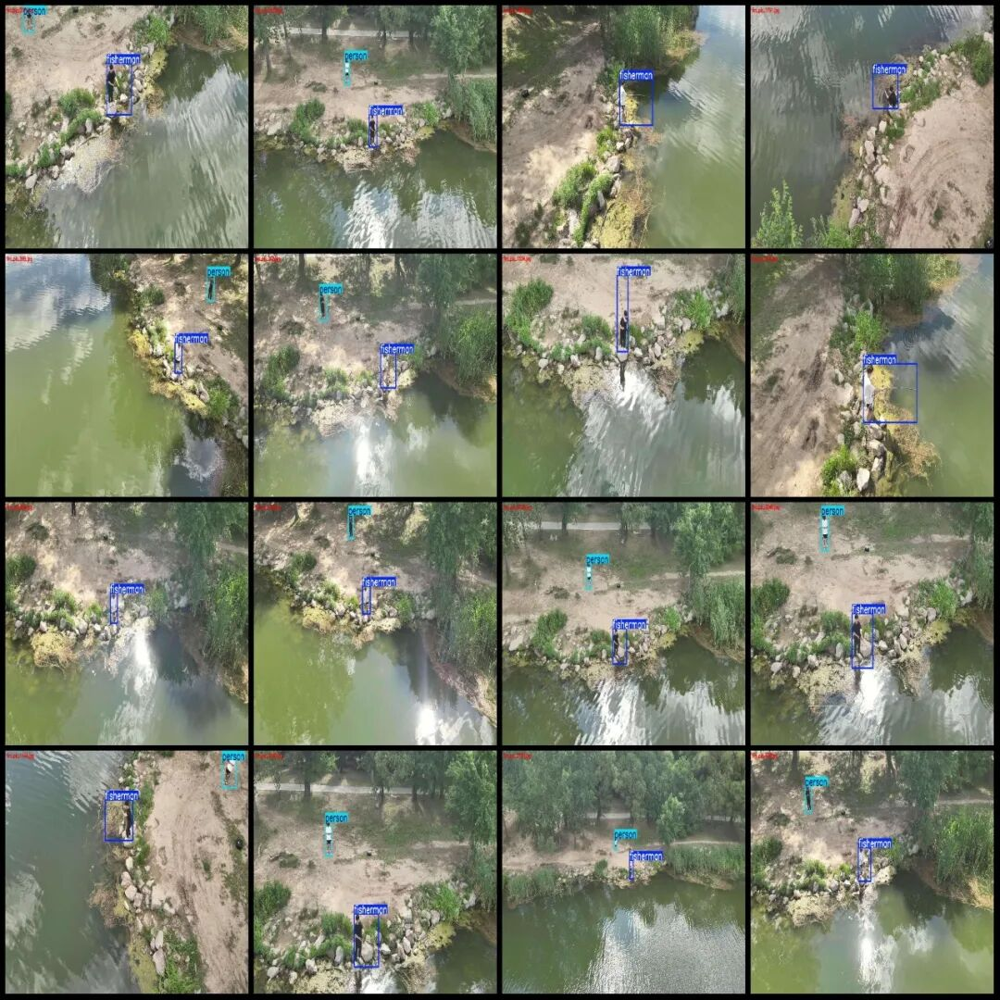
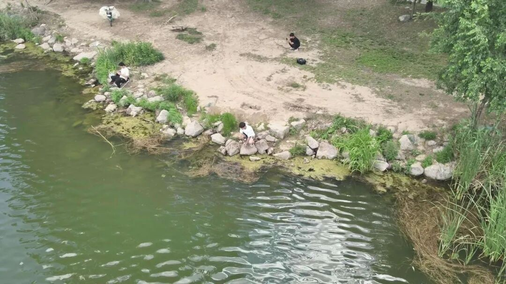
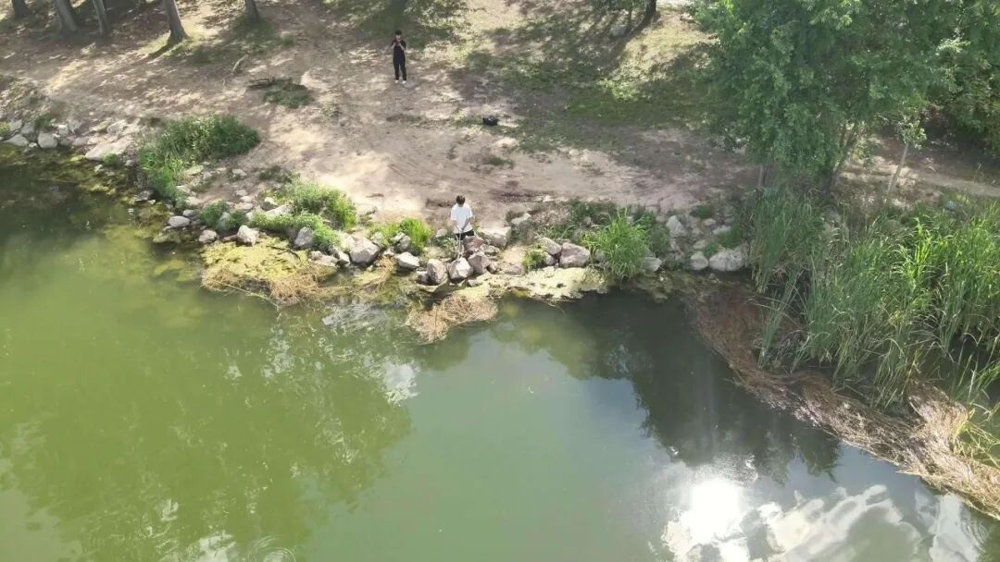
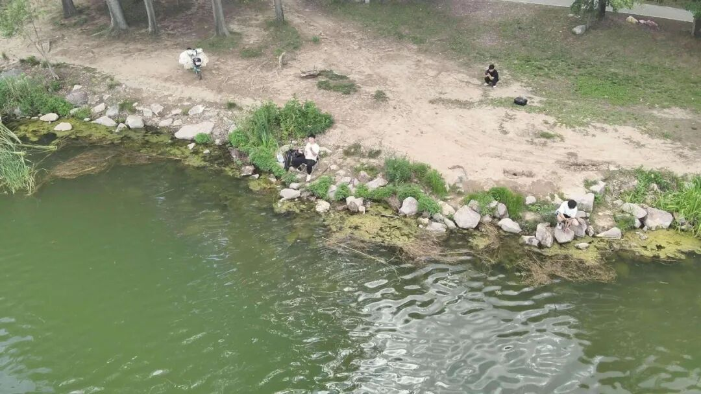

# Drone-View Aerial Photography Riverside Fishing Detection Dataset VOC+YOLO format with 3952 images in 2 categories

Please note that the dataset images are formed by extracting frames from drone video, all taken from the same scene. Therefore, there is a relatively high repetition rate in the scene images (the actual images are not duplicates). For specifics, please refer to the provided images.

Dataset format: Pascal VOC format + YOLO format (txt file without split path, only containing jpg images and corresponding VOC format xml files and yolo format txt files)

Number of images (number of jpg files): 3952

Number of annotations (number of xml files): 3952

Number of annotations (number of txt files): 3952

Labeling category count: 2

Label category names (note that the order of categories in the YOLO format does not correspond to this, but is based on the labels folder's classes.txt): ["fisherman", "person"]

Number of boxes and the number of images occupied by each category:

Fisherman (fishing) Frames = 4584, Pictures = 3880

Person (non-fishing person) Frames = 2383, Pictures owned = 2372

Total frame count: 6967

Image resolution: 1920x1080

Using labelImg:

Annotation rules: Draw a rectangle around the category.

Important Notice: The dataset does not have separate training, validation, and test sets; you need to partition them yourself.

Special : This dataset does not guarantee the accuracy of the trained models or weight files.

Image Preview:

Annotation example:

Single image:

## Payment

Here is a pay link on Stripe ( https://buy.stripe.com/3cs8yP7sY87d0vu9AB ). Please contact me lonlonago@foxmail.com after funding $89, and I will send you a complete data files , thank you!

